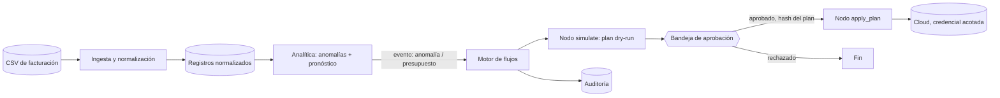
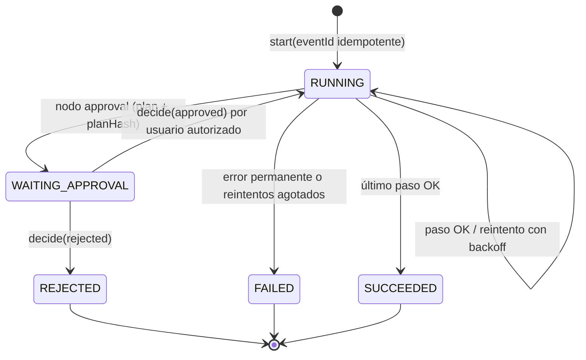

# CloudForge FinOps

Orquestador de automatización FinOps: convierte datos de facturación cloud en recomendaciones, y las recomendaciones en **acciones verificables** que nunca se aplican sin un plan *dry-run* y una **aprobación humana explícita**.

> **Estado: prototipo ejecutable del núcleo (fases 1–4 en versión mínima).** Ver [Qué está implementado](#qué-está-implementado) — el resto de la arquitectura es diseño, no código.

## Arquitectura



| Capa | Objetivo (diseño) | En este repo |
|---|---|---|
| Analítica | Python + FastAPI | `analytics/` — Python sin dependencias (+ wrapper FastAPI opcional en `api.py`) |
| Motor | Node + BullMQ + Redis | `engine/` — Node sin dependencias, almacén en memoria, conectores inyectados |
| Frontend React, API NestJS, PostgreSQL, S3/MinIO, Terraform | | **No implementado** |

## Diagrama de estados del motor



El estado se persiste tras cada paso, así que `resume()` tras un reinicio continúa sin repetir pasos ya completados.

## Qué está implementado

* **Ingesta** (`analytics/cloudforge_analytics/ingest.py`): CSV, monedas mixtas con tipos de cambio explícitos, duplicados reportados, filas inválidas rechazadas con motivo, recursos sin etiqueta `owner` marcados. Cada total devuelve los `record_id` y líneas del CSV origen (trazabilidad).
* **Anomalías** (`anomaly.py`): mediana móvil + MAD; cada hallazgo incluye método, ventana, umbral y explicación.
* **Pronóstico** (`forecast.py`): gasto acumulado + media de la ventana × días restantes, intervalos 80/95 %, supuestos listados.
* **Motor** (`engine/src`): definiciones inmutables, reintentos con backoff, timeouts, idempotencia, aprobación humana ligada al hash del plan, multi-tenant, enmascarado de secretos, nodos IA con esquema estricto, guardia SSRF.
* **Dataset sintético** (`datasets/`): 61 días, 2 anomalías inyectadas (`ground_truth.json`), 1 duplicado, 2 filas inválidas, recursos huérfanos sin etiquetar. Regenerable: `python3 datasets/generate_dataset.py`.
* **Ejemplos de flujos**: `examples/workflows/*.json|yaml`.

No implementado: conectores reales a proveedores, cola BullMQ/Redis, persistencia PostgreSQL, API REST NestJS (los endpoints de abajo son el contrato objetivo; solo `/costs/summary`, `/anomalies` y `/forecasts` tienen un wrapper FastAPI opcional), UI y capturas de pantalla.

## Ejecutar

```bash
python3 -I -m unittest discover -s analytics/tests -v   # 12 tests
(cd engine && npm test)                                 # 16 tests
```

## API REST objetivo

`POST /api/v1/cost-imports` · `GET /api/v1/costs/summary` · `GET /api/v1/forecasts` · `GET /api/v1/anomalies` · `POST /api/v1/workflows` · `POST /api/v1/workflows/{id}/run` · `POST /api/v1/recommendations/{id}/simulate` · `POST /api/v1/approvals/{id}/decision` · `GET /api/v1/executions/{id}`

## Seguridad

Controles, código que los aplica y el test que los prueba: [docs/SECURITY.md](docs/SECURITY.md).

## Criterios de aceptación del MVP

| Criterio | Evidencia |
|---|---|
| Totales trazables a registros origen | `test_total_is_traceable_to_source_rows` |
| Anomalías/pronósticos muestran método, periodo, incertidumbre | `test_forecast_explains_itself`, `test_detects_exactly_injected_anomalies` |
| Flujo se pausa ante cambio crítico y reanuda tras aprobación | `recovers after worker restart while waiting for approval` |
| Sin cambios en la nube sin validación humana | `pauses for approval…`, `destructive step refuses to run…`, `publish rejects destructive nodes…` |
